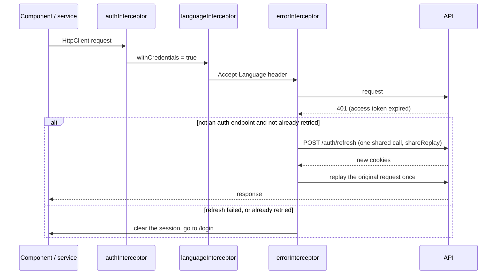

[Back to README](../README.md)

# Architecture

The whole platform (browser, nginx, API, database, outside services) is drawn in the API's
[Architecture at a Glance](https://github.com/LouziAmine/---Credit-Bladi---/blob/release/2.1.0/docs/c4-architecture.md).
This page covers the front end only.

## Folder structure

```
src/app/
  layouts/        header (menu, language switch, session, notification bell) and footer
  pages/          one folder per route
    mortgage-credit/, investment-credit/   public simulators and their result components
    login/, register/, invitations/        authentication and invitation acceptance
    admin/        back office: demands (list, Excel import, dossier detail), users, enterprises,
                  enterprise-links, activity-sectors, document-suggestions, audit-log, and the four
                  parameter pages (bam-parameters, credit-rates, mourabaha-parameters,
                  investment-credit-parameters) built on versioned-parameters-page.ts
    portal/       client portal: portfolio, portfolio-demands, portal-demand-detail
  core/
    guards/       authGuard, guestGuard, managerGuard, clientGuard
    interceptors/ authInterceptor, languageInterceptor, errorInterceptor
    services/     one service per API resource (HttpClient only lives here)
    models/       TypeScript contracts of the API's DTOs, option lists, simulator limits
    utils/        format.utils.ts (MAD, percent, duration), http-error.handler.ts
  shared/
    components/   error-message, loading-spinner, document-upload, document-request-list,
                  document-viewer-overlay, bam-verification-panel, early-repayment-panel,
                  product-highlights
    validators/   password-complexity, strictly-positive
  testing/        test-only helpers and the mock data used by every spec (mocks/)
src/environments/ apiUrl per build configuration
e2e/              Playwright specs and their shared helpers (world.ts, morocco.ts)
deploy/nginx/     production server configuration
tools/            preview-server.mjs (Lighthouse and ZAP target), purge-css.mjs, generate-images.mjs
```

Dependencies point inward: `pages/` and `layouts/` use `core/` and `shared/`; `core/` never imports a page,
and services never import components.

## Conventions

| Convention | Where | Why |
|---|---|---|
| Standalone components | Every component | No `NgModule`; each component lists its own `imports` |
| `OnPush` and signals | Every component | A component re-renders only when an input, a signal or a DOM event changes |
| Container and child components | `demand-detail` and its `demand-*` children; each simulator and its result component | The container loads data; each child owns one part (classification, credit file, history, step actions) |
| Shared parameter pages | `versioned-parameters-page.ts` and `versioned-parameters-layout` | The four parameter pages share loading, selection, patching and messages; each one only supplies its form mapping |
| One home for simulator limits | `core/models/simulation-limits.model.ts` | Mirrors the API's `ValidationConstraints`; forms, sliders and `min`/`max` all read it |
| Functional guards | `core/guards/` | `/admin` uses `[authGuard, managerGuard]`, `/portal` uses `[authGuard, clientGuard]`, `/login` and `/register` use `guestGuard` |
| Typed reactive forms | Every form | `fb.nonNullable.group(...)`, typed at compile time |
| Lazy routes | `app.routes.ts` | Every route uses `loadComponent()` except the landing page (mortgage simulator), loaded eagerly to avoid a layout shift |
| Session bootstrap | `app.config.ts` (`APP_INITIALIZER`) | Calls `GET /auth/me` once before the first render, so a page refresh keeps the session |
| Translations | `public/i18n/<screen>/<lang>.json`, ngx-translate | French, English and Arabic (right to left); option labels live only in the translation files |

## Authentication and session refresh

The tokens are `HttpOnly`, `SameSite=Strict` cookies set by the API. JavaScript never sees them: `TokenService`
only keeps the username and the role as signals.



- `GET /auth/me` never redirects on a `401`: it runs on every page load, including for anonymous visitors on
  the public simulators.
- If several calls fail at once, they share a single refresh request, so the API's token rotation is never
  raced.

The full login and refresh path through the API is in
[Feature Flows: Login](https://github.com/LouziAmine/---Credit-Bladi---/blob/release/2.1.0/docs/flows/01-login.md).

## Errors

Each service pipes its call through `handleHttpError(service, operation)`, which logs in development builds
and rethrows. The component then shows `ApiErrorMessageService.describe(err, fallbackKey)`: the API's
message, already translated, or the screen's fallback text. Every page uses the same pair of
`loading` / `errorMessage` signals.

## Real-time notifications

`NotificationBellComponent` opens an `EventSource` on `GET /api/v1/notifications/stream` when it is shown, and
closes it when it is destroyed. The header shows it only to a logged-in `MANAGER`, and the API's notification
endpoints are `MANAGER`-only too; clients are told by e-mail and SMS. The stream sends a ping every 15 s, and
a 5-minute poll of the unread count acts as a safety net.

## Build and delivery

| | |
|---|---|
| Production build | `npm run build`: hashed file names, minification, budgets (initial bundle: warning 800 kB, error 1.2 MB; component styles: warning 4 kB, error 8 kB), then PurgeCSS removes unused Bootstrap rules |
| Production server | nginx image (`Dockerfile`, `deploy/nginx/default.conf.template`): serves the SPA, proxies `/api/`, sends CSP, HSTS and cache headers |
| Preview server | `tools/preview-server.mjs` (Express and Helmet): serves the production build locally for Lighthouse and ZAP |
| Assets | Bootstrap, Bootstrap Icons and the Poppins font are bundled; nothing is loaded from a CDN |

See [Deployment](deployment.md) for the CI/CD pipeline.

## Patterns in use

| Pattern | Where |
|---|---|
| Facade | Each `core/services/*` service: one typed method per API endpoint, components never use `HttpClient` |
| Chain of Responsibility | The three HTTP interceptors, in registration order |
| Observer | Signals and `computed()` for UI state; `EventSource` for server events |
| Adapter | `http-error.handler.ts` and `ApiErrorMessageService` turn an `HttpErrorResponse` into one message |
| Composite | The dossier screen: `demand-detail` and its child components |
| Template Method | `VersionedParametersPage` with its product-specific hooks |
| Content projection | `VersionedParametersLayoutComponent` slots (`[parametersTable]`, `[parametersEditor]`) |
