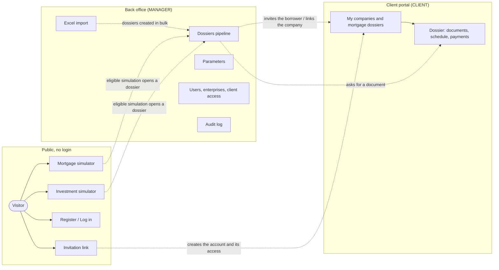

[Back to README](../README.md) · [User Guide](user-guide/README.md)

# Application Overview

What the portal lets people do, screen by screen, for product owners and business readers. The rules behind
the numbers (BAM checks, CSP profiles, Mourabaha, enterprise types, the instruction steps) are described in
the API's [Mortgage Credit](https://github.com/LouziAmine/---Credit-Bladi---/blob/release/2.1.0/docs/mortgage-credit-workflow.md)
and [Enterprise Credit](https://github.com/LouziAmine/---Credit-Bladi---/blob/release/2.1.0/docs/enterprise-credit-workflow.md)
documents.

## Who can do what

| Role | Can do |
|---|---|
| Visitor (not logged in) | Simulate a mortgage (`/mortgage-credit`, the landing page) or a company investment loan (`/investment-credit`), register, log in, accept an e-mail invitation (`/invitations/:token`) |
| Client (`CLIENT`) | The same, plus the client portal (`/portal`): the companies and mortgage dossiers they have access to, requested documents, the repayment schedule, payment declarations, an early repayment quote |
| Bank staff (`MANAGER`) | Everything in the back office (`/admin`): dossiers, parameters, users, enterprises, client access, audit log, Excel import, and the notification bell |

Registering always creates a `CLIENT` account. Only a manager can create another manager, or promote a client,
from the Users screen.

## 1. Simulators

**Mortgage (`/mortgage-credit`).** One form: amount (70,000 to 30,000,000 MAD), property value, duration
(12 to 300 months), product (conventional or Mourabaha), professional category (CSP), age, nationality,
residence, monthly income and an optional co-borrower. The answer is either a full breakdown (rate, monthly
payment, insurance, fees, TEG, total cost, schedule) or the exact reason for a refusal (deposit, age at
maturity, debt ratio, duration, legal rate ceiling).

**Investment (`/investment-credit`).** The same for a company: identity, activity sector, contact, size
(TPE, auto-entrepreneur, PME, ETI, GE), age and financials (revenue, net result, existing debt service,
guarantees), amount (50,000 to 100,000,000 MAD) and duration.

In both cases, an eligible simulation opens a dossier for the bank and shows its reference. The visitor has
nothing else to do. A new simulation by the same person (same name and e-mail) on a dossier that is not
classified yet updates that dossier instead of opening a second one.

## 2. Accounts

- **Register** (`/register`) and **log in** (`/login`) are reachable only when logged out. The session is kept in
  `HttpOnly` cookies and renews itself silently.
- **Invitation** (`/invitations/:token`), from an e-mail: the person sees who invited them, chooses a username and
  a password, and their account is created with its access already granted (to a company, or to their own
  mortgage dossier).

## 3. Back office (`/admin`)

Hidden from the menu and blocked for anyone who is not a manager.

| Screen | What a manager does there |
|---|---|
| Dossiers (`/admin/demands`) | Filter and open every dossier. See [Dossier detail](#4-dossier-detail-admindemandsid) below |
| Excel import (`/admin/demands/import`) | Create dossiers in bulk from an `.xlsx` file; the report lists each rejected row and why |
| BAM parameters | Debt ratio, minimum deposit (LTV), age at maturity, borrower insurance, fee ratios |
| Credit rates | Rate range and duration range per CSP |
| Mourabaha parameters | Profit margin, VAT, takaful |
| Investment parameters | Eligibility thresholds, rate range and fees per enterprise type |
| Enterprises | Client companies attached to dossiers |
| Enterprise links | Pending access requests from clients (approve or reject), invitations, revocations |
| Activity sectors, Document suggestions | Reference lists used by the forms |
| Users | Create staff accounts, change a role, set grade, team and e-mail (never on one's own account) |
| Audit log | Who did what, when, from which IP, with the before and after values |

Every parameter change applies to the very next simulation and is written to the audit log. Parameters in
force when the committee approves a dossier are frozen for that dossier.

## 4. Dossier detail (`/admin/demands/:id`)

| Part | What it does |
|---|---|
| Classify | First step only: confirms the dossier is real (and attaches the company, or invites the mortgage borrower) or closes it as fake or simulation only. A simulated BAM check (SCIP, Centrale des Risques) is shown next to the form |
| Assign | Gives the current step to an eligible colleague |
| Advance / return | Closes the step and opens the next one, or sends the dossier back one step with a reason. Before the committee, the amount, rate and duration can be kept or changed; after its decision they are fixed |
| Four-eyes rule | Whoever handled an earlier step cannot take the committee decision |
| Comment | A note on the current step |
| Documents | Upload, preview and download; a new file of the same type replaces the previous one. Every upload is scanned by the antivirus |
| Request a document | Asks the client for a specific document; the client is notified and sees the request in the portal |
| Pipeline, history, assignments | Progress of every step, the decisions and terms before and after, every hand-off |
| Credit file | Opens once the last step is closed: disbursed amount, the bank's RIB, the schedule with each installment's status, payment validation or rejection, early repayment |

## 5. Client portal (`/portal`)

A client sees something here once they have access to a company or to a mortgage dossier:

- **Invited** by a manager (e-mail link, or an existing account), or a mortgage borrower invited when their
  dossier is classified.
- **Claim**: the client enters the company's registration number; a manager approves it.

| Screen | What the client sees |
|---|---|
| Portfolio (`/portal`) | Their companies, their mortgage dossiers, and the status of their access requests |
| Company dossiers (`/portal/:enterpriseId/demands`) | Each dossier of that company and its current step |
| Dossier (`.../demands/:demandId`, `/portal/mortgage/:demandId`) | Requested documents (upload PDF, image, Word or Excel up to 15 MB), and once approved: the schedule, a "J'ai payé" declaration per installment, an early repayment quote |

The client never changes the processing of a dossier: they follow it, answer document requests and declare
payments.

## 6. Payments

There is no payment gateway. A client declares a payment ("J'ai payé", with the RIB they paid from); a manager
checks the bank statement and validates it or rejects it with a reason. Each side is notified. A daily job
flags overdue installments and reminds the client by e-mail and SMS.

## 7. Notifications

| Who | Channel | When |
|---|---|---|
| Staff | Bell in the header, live (Server-Sent Events), plus e-mail if one is set | A new dossier waits for their step, a step is assigned to them, a client answered a request or declared a payment |
| Clients | E-mail and SMS | A document is requested, a payment is validated or rejected, an installment is overdue, an invitation |

Clients have no bell in the portal yet: the API's notification endpoints are reserved for staff.
