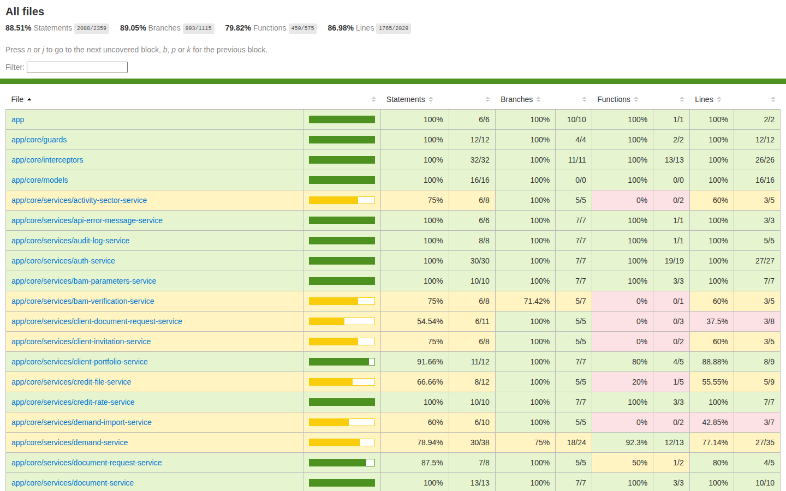
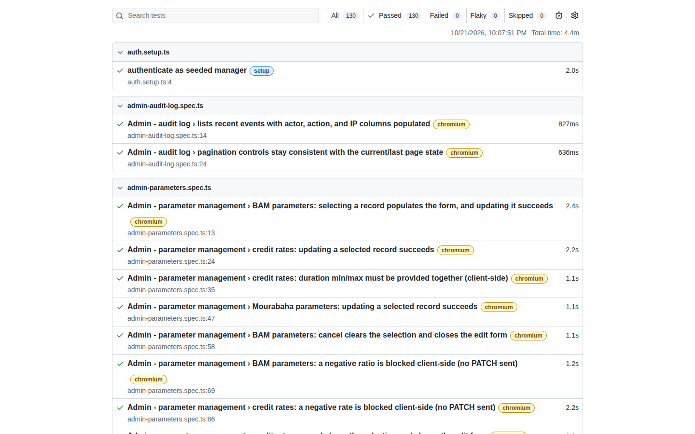
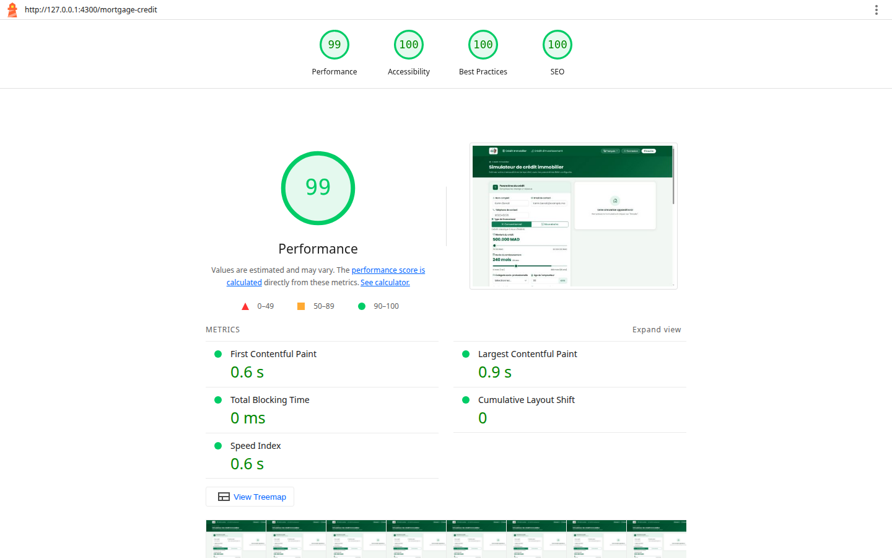

[Back to README](../README.md)

# Testing

## Commands

| Suite | Command | Needs |
|---|---|---|
| Unit (Vitest) | `npm test`, or `npm run test:coverage` for coverage and thresholds | Nothing |
| End to end (Playwright) | `npm run test:e2e` | The API, see below |
| Performance (Lighthouse CI) | `npm run test:perf` | Nothing (builds and serves the production bundle) |
| Lint and static security rules | `npm run lint` | Nothing |
| Dependency audit | `npm run test:security:sca` | Network |
| Dynamic security scan (OWASP ZAP) | `npm run test:security:dast` | Docker |

`./run-tests.sh` offers the same commands as a menu. The CI pipeline runs lint, unit tests with coverage, the
dependency audit and the production build on every push ([Deployment](deployment.md)).

## Current results (2026-10-21)

| Suite | Result |
|---|---|
| Unit tests | 460 tests in 55 files, all passing |
| Coverage | 88.5 % statements, 89.1 % branches, 79.8 % functions, 87.0 % lines |
| End to end | 130 tests, all passing (about 4.5 min, one worker) |
| Lighthouse | Performance 99, Accessibility 100, Best Practices 100, SEO 100 on `/` and `/login` |
| Lint | 0 errors, 0 warnings |
| Dependency audit | No high or critical vulnerability in production dependencies |

The coverage thresholds in `angular.json` (statements 87, branches 89, functions 79, lines 85) are a ratchet:
raise them when coverage goes up, never lower them.

## Unit tests

Specs sit next to the code they test (`*.spec.ts`). `src/app/testing/translate-testing.providers.ts` loads the
real translation files from disk, so assertions check the text users actually see; add
`provideTranslateTesting()` to a spec that renders translated text.

**Test data.** Specs never hard-code business values. Usernames, contacts, company names, codes, dossier
references, dates, amounts and rates are defined once in `src/app/testing/mocks/` and imported where needed.
Add a new value there rather than writing a literal in a spec.

Coverage report (`coverage/bladi-credit-portal/lcov-report/index.html`):



## End-to-end tests

The specs drive a real browser against `ng serve` and the real API. Start the API in its `dev` profile with
PostgreSQL, ClamAV and Mailpit (`docker compose up -d` in the API repository), with raised rate limits and the
four-eyes rule on:

```bash
./mvnw spring-boot:run -Dspring-boot.run.profiles=dev -Dspring-boot.run.arguments="\
--security.rate-limit.auth.max-requests=1000 --security.rate-limit.mortgage-credit.max-requests=1000 \
--security.rate-limit.refresh.max-requests=1000 --workflow.four-eyes.enabled=true"
npm run test:e2e
```

If the API runs on another port, set `E2E_BACKEND_URL` and the `apiUrl` of
`src/environments/environment.development.ts`. Without the API, the specs that need it skip themselves.
`e2e/world.ts` holds the shared setup (staff for every grade and team, API helpers, generated PDF, Excel and
antivirus test files, a Mailpit reader) and `e2e/morocco.ts` the fictitious companies and people. Each run
rewrites the screenshots in `docs/screenshots/e2e/`, which the [User Guide](user-guide/README.md) uses; run it
on a fresh database before committing them.

| Spec | Covers |
|---|---|
| `auth.setup.ts`, `auth.spec.ts` | Manager session reused by the other specs; login, validation, guards, unknown routes |
| `register.spec.ts` | Password rules, duplicate username, registration then login |
| `security.spec.ts` | XSS, password field, no token in storage, cookie flags, silent refresh, logout |
| `simulation.spec.ts` | Conventional and Mourabaha, co-borrower, schedules, every refusal, form checks |
| `investment-credit.spec.ts` | Eligible PME and GE, schedule, the four refusals, required fields |
| `demand-workflow.spec.ts` | An investment dossier end to end, by each required staff profile |
| `mortgage-workflow.spec.ts` | Mortgage dossiers: four-eyes rule, committee refusal, Mourabaha credit file, borrower invitation and payment |
| `client-portal.spec.ts` | Invitation, portfolio, document requests, payments, early repayment, access claims and revocation |
| `admin-users.spec.ts`, `admin-parameters.spec.ts`, `admin-referential.spec.ts`, `admin-audit-log.spec.ts` | Users, parameter pages, reference data, Excel import, audit log |
| `ux.spec.ts` | Languages and right-to-left Arabic, one dossier per person, phone width, keyboard use, axe accessibility scan |

The suite runs with one worker because the API's rate limits are per IP. Report
(`playwright-report/index.html`, `npx playwright show-report`):



## Performance

Lighthouse CI builds the production bundle, serves it with `tools/preview-server.mjs` (compression, cache and
security headers like the production image) and scores `/` and `/login` three times each. `lighthouserc.js`
fails the run below Performance 85, Accessibility 95 or Best Practices 90, or when LCP exceeds 2.5 s, TBT
300 ms or CLS 0.1. Reports land in `lighthouse-report/`.



## Security checks

- **Static rules**: ESLint with `eslint-plugin-security`, part of `npm run lint`.
- **Dependencies**: `audit-ci` fails on a high or critical vulnerability in a production dependency.
- **Dynamic scan**: `security/run-zap-scan.sh` runs OWASP ZAP in Docker against the preview server (crawl with
  the Ajax spider, then an active scan of the public pages). It is not part of CI; run it before a release and
  attach `security/zap-report.html`.
